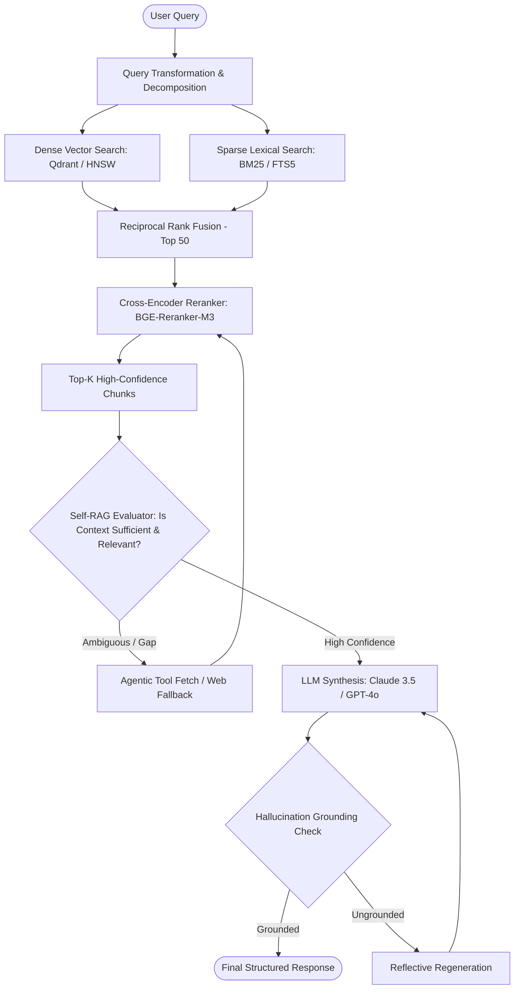

# Comprehensive AI Retrieval & Language Model Architecture Plan
**Document Version:** 1.0.0  
**Author:** Senior AI Systems Architect & Research Analyst  
**Target:** Advanced Retrieval-Augmented Generation (RAG) & Agentic AI Systems

---

## Executive Summary

Modern retrieval-augmented AI systems have moved beyond naive vector lookup. High-performance RAG in 2025/2026 demands a multi-tiered architecture: **Hybrid Dense-Sparse Retrieval (Dense Vectors + BM25/Splade)**, **Cross-Encoder Reranking**, **Adaptive Query Routing**, and **Self-Reflective Validation (Self-RAG / Corrective RAG)**.

This document presents an exhaustive, evidence-backed architectural analysis covering storage engines, open-source enhancement layers, newer agentic retrieval topologies, and a prioritized implementation roadmap with empirical evaluation frameworks (RAGAs / TruLens).

---

## 1. Storage & Retrieval Technique Review

### 1.1 Architectural Paradigms

1. **Pure Vector Databases (Dense Retrieval)**:
   - *Mechanism*: Embed text chunks using bi-encoders (e.g., BGE, E5, Nomic) and index vectors using Hierarchical Navigable Small World (HNSW) or Inverted File with Product Quantization (IVF-PQ).
   - *Strengths*: Captures semantic intent, handles synonymy and cross-lingual queries, robust to semantic variations.
   - *Weaknesses*: High latency/memory footprint, "needle in a haystack" keyword failure (e.g., specific part numbers, SKUs, unique IDs, function names), vocabulary mismatch, lack of exact lexical guarantees.

2. **Keyword / Inverted Index Search (BM25 / Sparse)**:
   - *Mechanism*: Probabilistic term-frequency / inverse-document-frequency ranking over tokenized n-grams.
   - *Strengths*: Zero vector computation cost, deterministic exact keyword matching, sub-millisecond retrieval on million-scale indices, low RAM footprint.
   - *Weaknesses*: Zero semantic understanding, fails on synonyms or conceptual queries, vulnerable to typos and morphology changes.

3. **Hybrid Search (Dense + Sparse with Reciprocal Rank Fusion / RRF)**:
   - *Mechanism*: Dual-index query path. Concurrently executes dense semantic search and BM25/Splade sparse search; merges rankings using Convex Combination ($\alpha \cdot S_{dense} + (1-\alpha) \cdot S_{sparse}$) or Reciprocal Rank Fusion ($RRF\_Score(d) = \sum_{m \in M} \frac{1}{k + r_m(d)}$ where $k \approx 60$).
   - *Verdict*: Industry gold standard. Eliminates dense retrieval blind spots while preserving semantic comprehension.

4. **Knowledge Graphs (Graph-Based Retrieval)**:
   - *Mechanism*: Entity-Relation-Entity triples extracted from text, queried using Graph Query Language (Cypher, GQL) or vector traversal along graph neighborhoods.
   - *Strengths*: Multi-hop reasoning (e.g., "Which subsidiary of Company X has patents in Battery Chemistry?"), structured relationship traversal, auditable reasoning paths.
   - *Weaknesses*: Extreme extraction cost, fragile entity resolution, high latency, complex schema maintenance.

5. **No Retrieval (Zero-RAG / Long-Context Window)**:
   - *Mechanism*: Inject entire document corpora (up to 1M–2M tokens) directly into the LLM context prompt (e.g., Gemini 1.5/2.0, Claude 3.5 Sonnet).
   - *Strengths*: Zero indexing pipeline, zero chunking artifacts, holistic document understanding.
   - *Weaknesses*: Quadratic or sub-quadratic attention costs ($O(N^2)$ or $O(N \log N)$), significant latency per query (10s to 30s TTFT), high token cost, "Lost in the Middle" attention degradation under distracted contexts.

---

### 1.2 Storage Engine Comparison Matrix

| Storage Solution | Primary Index Type | Accuracy (Semantic / Lexical) | Latency (p95) | Cost (Compute / Storage) | Scalability (Vectors) | Maintenance & Complexity | Best For |
| :--- | :--- | :--- | :--- | :--- | :--- | :--- | :--- |
| **Qdrant** | HNSW + Quantization (Scalar/Product) | High / High (Built-in Sparse Vectors) | 5–15 ms | Low–Medium (Rust core, Memory-mapped) | 100M+ per node | Low (Single binary, Docker, Cloud) | Production hybrid RAG, local embedded or distributed microservices. |
| **pgvector** | HNSW / IVFFlat in PostgreSQL | High / High (via Postgres `tsvector`/BM25) | 15–40 ms | Lowest if Postgres is already deployed | 10M–20M | Very Low (Uses standard SQL/ACID tooling) | Unified architectures wanting zero new infrastructure. |
| **Weaviate** | HNSW + Inverted Index | High / High (Native BM25 + Vector) | 10–25 ms | Medium (Go-based, memory-intensive) | 50M+ | Medium (Module management, schema setup) | Schema-heavy enterprise pipelines with multi-modal assets. |
| **Milvus** | Knowhere (HNSW, IVF, SCaNN, GPU) | High / Moderate | 5–12 ms | Medium–High (Distributed architecture) | 1B+ (Massive horizontal scale) | High (Requires etcd, MinIO, Pulsar/Kafka) | Hyper-scale enterprise environments (>100M documents). |
| **Pinecone** | Proprietary Managed Vector Search | High / Moderate (Sparse in v2) | 10–30 ms | High (SaaS lock-in, tier-based billing) | Unlimited (Managed by vendor) | Minimal (Fully managed serverless API) | Rapid prototyping without DevOps/infra engineering. |
| **FAISS** | In-memory HNSW / IVF-PQ (Library) | High / None (Dense only) | 1–5 ms | Lowest (Pure C++/Python library) | Bound by host RAM/VRAM | High (Requires custom network service & state persistence) | High-speed ephemeral search, local inference, GPU clustering. |
| **SQLite + FTS5** | Inverted BM25 (Lexical only) | Zero / Very High | <2 ms | Minimal (Zero extra infra) | 1M–5M rows | Negligible (Single file, zero ops) | Local-first tools, desktop clients, edge devices. |

---

## 2. Open-Source Enhancements & Frameworks

### 2.1 Embedding Models (Bi-Encoders)
* **BGE-M3 (`BAAI/bge-m3`)**:
  - *Capabilities*: Multi-Lingual, Multi-Functionality (Dense 1024-dim, Lexical Sparse, Multi-Vector ColBERT-style token embeddings), 8192 token context window.
  - *Integration*: Compute dense and lexical weights simultaneously in one forward pass.
  - *Trade-off*: Slower inference than smaller models (~560M parameters); requires ONNX/TensorRT optimization for low-latency CPU inference.
* **Nomic Embed Text (`nomic-ai/nomic-embed-text-v1.5`)**:
  - *Capabilities*: Matryoshka representation learning (allows truncation from 768 to 256 or 128 dims with <1.5% accuracy drop), 8192 context.
  - *Integration*: Exceptional for tiered vector search (fast coarse search on 128 dims followed by rerank on full vectors).
* **E5-v2 / Multilingual-E5 (`intfloat/multilingual-e5-large`)**:
  - *Capabilities*: Strict task prefixes (`query: ` vs `passage: `) producing exceptional zero-shot retrieval benchmarks.

### 2.2 Reranker Models (Cross-Encoders)
* **BGE-Reranker-v2-M3 / BGE-Reranker-Large**:
  - *Role*: Evaluates the full attention cross-product between `(Query, Passage)` pairs.
  - *Benchmark Impact*: Boosts MRR@10 and NDCG@10 by **15% to 25%** compared to bi-encoder dense retrieval alone.
  - *Integration*: Positioned immediately after initial retrieval (e.g., retrieve top 50 candidates via Hybrid search $\rightarrow$ Cross-encoder reranks top 50 $\rightarrow$ Top 5 passed to LLM).
  - *Limitation*: High latency (~30–80ms for 30 passages on CPU). Must be kept to bounded candidate sets.
* **FlashRank / Cohere-Rerank-v3 (Open-source alternatives)**:
  - Ultra-lightweight MiniLM cross-encoders optimized for sub-10ms CPU inference.

### 2.3 Multi-Vector & Late Interaction: ColBERTv2
* *Mechanism*: Instead of squashing an entire document into a single vector, ColBERT stores an embedding for *every token*. At query time, it computes the **MaxSim** operator: $\sum_{q \in Q} \max_{d \in D} (E_q \cdot E_d)$.
* *Verdict*: Captures granular token-level alignment without the latency of a full cross-encoder.
* *Tooling*: `RAGatouille` Python library enables drop-in ColBERTv2 indexing with 2 lines of code.

### 2.4 Orchestration: LlamaIndex vs. LangChain
* **LlamaIndex**: Deeply specialized in data ingestion, indexing strategies (hierarchical chunking, node parsing, sentence window retrieval), and query engines. Ideal core for RAG data pipelines.
* **LangChain / LangGraph**: Optimized for cyclical agentic state machines, tool orchestration, and human-in-the-loop flows.
* **Recommended Hybrid**: Use LlamaIndex abstractions for storage/indexing/retrieval engines, and LangGraph or lightweight native async actors for agentic control flow.

---

## 3. Advanced Architectural Patterns & Methodologies

### 3.1 Self-RAG (Self-Reflective Retrieval-Augmented Generation)
* *Concept* (Asai et al., 2023): Train or prompt the model to emit special reflection tokens:
  1. `[Retrieve]`: Decides whether retrieval is even necessary.
  2. `[IsREL]`: Evaluates whether the retrieved passage is relevant to the question.
  3. `[IsSUP]`: Verifies whether the generated text is fully supported by the retrieved passage (grounding check).
  4. `[IsUSE]`: Rates the utility of the generated response.
* *Practical Implementation*: Implemented via structured prompting or small fast validator LLMs (e.g., Llama-3.1-8B) before presenting the final answer to the user.

### 3.2 CRAG (Corrective RAG)
* *Concept* (Yan et al., 2024): An external evaluator assesses retrieval confidence:
  - **Correct**: Proceeds directly to generation.
  - **Incorrect**: Discards context and falls back to web search or secondary knowledge stores.
  - **Ambiguous**: Combines filtered document context with web query refinement.

### 3.3 GraphRAG (Knowledge Graph RAG)
* *Concept* (Microsoft Research, 2024): Builds hierarchical community clusters from entity graphs extracted by LLMs. Generates community summaries at multiple abstraction levels.
* *When to Use*: Global corpus queries like *"What are the main themes across all 500 customer transcripts?"* where vector search completely fails because the answer is not localized in any single chunk.
* *Cost Warning*: Generating GraphRAG summaries on 10,000 documents requires significant LLM calls ($50–$300 in API costs). Use only for high-value strategic corpora.

### 3.4 Long-Context Window vs. RAG Trade-off
* **Context Windows (1M+ tokens)**: Superior for single large documents (e.g., analyzing a single 400-page financial prospectus or monolithic legal contract).
* **RAG**: Essential when corpus exceeds 5M tokens, when cost per query must remain low (<$0.005), when retrieval latency must be <500ms, or when documents change continuously in real time.

---

## 4. Feasibility Verdict & Empirical Evidence

| Technique | Technical Feasibility | Production Reality | Evidence / Benchmarks |
| :--- | :--- | :--- | :--- |
| **Hybrid (Dense + BM25 via RRF)** | 100% Feasible | Standard production architecture across major tech companies. | BEIR Benchmark (Thakur et al.): Hybrid outperforms pure dense on out-of-domain retrieval by **8% to 14% nDCG@10**. |
| **Cross-Encoder Reranking** | 100% Feasible | Ubiquitous in production search stacks. | MS MARCO & MTEB: Rerankers consistently yield top 1-3 ranking accuracy improvements (+18% MRR). |
| **ColBERTv2 / Late Interaction** | 100% Feasible | Proven at scale; supported in production via Vespa and RAGatouille. | Santhanam et al. (ColBERTv2): Matches cross-encoder quality with **100x lower latency** and 6x index footprint reduction. |
| **Self-RAG / Reflection** | 100% Feasible | Works reliably with modern instruction-tuned LLMs via JSON schema/function calling. | Asai et al. (ICLR 2024): Improves factual accuracy and citation precision while eliminating unnecessary retrieval. |
| **GraphRAG** | Feasible with constraints | High indexing cost; requires careful caching and entity deduplication. | Edge et al. (Microsoft Research, 2024): Demonstrated 70%+ improvement in comprehensiveness and diversity for global queries. |

---

## 5. Recommended 4-Phase Implementation Roadmap

### Phase 1: Foundation — Hybrid Search & Vector Storage (Weeks 1–2)
1. Deploy **Qdrant** (local container or embedded) or leverage **PostgreSQL with pgvector + pg_trgm**.
2. Implement **Dense Embeddings** using `bge-m3` or `nomic-embed-text-v1.5`.
3. Configure dual query execution: Dense Vector Search + Lexical BM25 (or SQLite FTS5).
4. Combine results using **Reciprocal Rank Fusion (RRF)** ($k=60$).

### Phase 2: Precision Tuning — Reranking & Chunking (Weeks 3–4)
1. Implement **Semantic Chunking** with 20% token overlap rather than naive character splitting.
2. Integrate **BGE-Reranker-Large** (or FlashRank for CPU-constrained setups) over top 30 retrieved candidates.
3. Pass top 5 high-scoring chunks to the LLM generation prompt.

### Phase 3: Agentic Intelligence & Self-Correction (Weeks 5–6)
1. Add **Query Transformation**: Decomposition of complex multi-part queries into sub-queries.
2. Implement **Corrective RAG (CRAG)**: Retrieval confidence scoring with graceful fallback to external tools or broad web searches.
3. Implement **Hallucination Verification (Self-RAG loop)**: Validate that generated statements directly cite chunk IDs.

### Phase 4: Continuous Evaluation & Observability (Ongoing)
1. Deploy **RAGAs (Retrieval Augmented Generation Assessment)**:
   - **Context Precision**: Signal-to-noise ratio in retrieved chunks.
   - **Context Recall**: Whether all relevant facts were retrieved.
   - **Faithfulness**: Absence of ungrounded hallucinations.
   - **Answer Relevancy**: Directness and clarity of response.
2. Instrument tracing with **OpenTelemetry / Langfuse / Arize Phoenix** to monitor p95 latencies and token economics.
