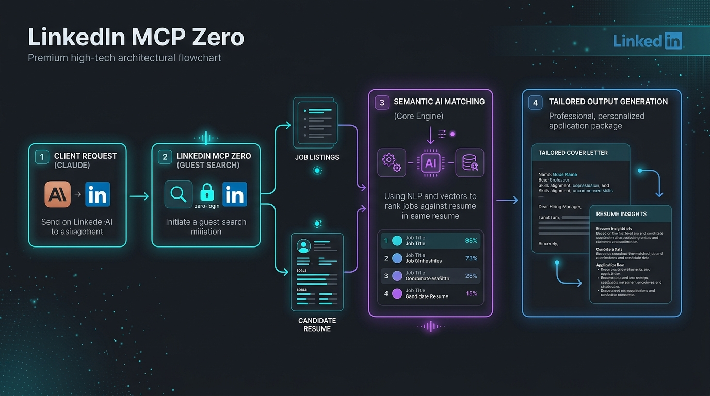
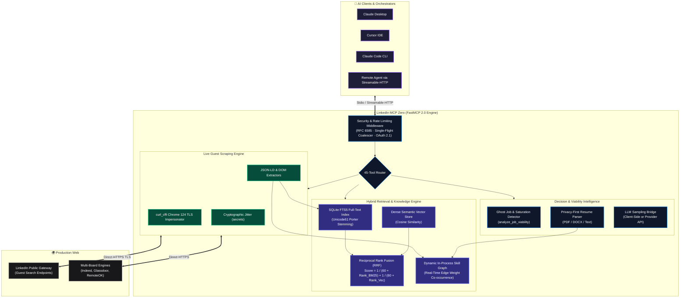
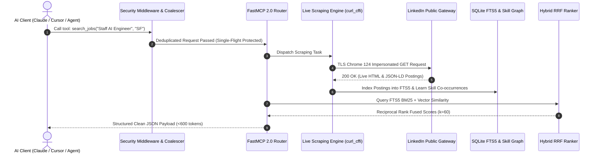

<div align="center" id="top">

<a href="#top">
  
</a>

<br/>
<br/>

[](https://pypi.org/project/linkedin-mcp-zero/)
[](https://www.python.org/)
[](https://modelcontextprotocol.io/)
[](https://modelcontextprotocol.io/)
[](tests/)
[](https://bandit.readthedocs.io/)
[](#tools)
[](LICENSE)

<br/>

**A high-performance, public-first Model Context Protocol (MCP) server for real-time LinkedIn talent intelligence, hybrid semantic RAG matching, ghost-job viability scoring, dynamic skill graphs, and privacy-first resume analysis.**

*Zero Login Required · Zero Mock Data · 45 Production Tools · FastMCP 2.0 Native · Dual Stdio/HTTP Transports*

<br/>

[⚡ Quickstart](#quickstart) •
[🎬 Live Demo](#demo) •
[🛠️ 45 Tools](#tools) •
[🏗️ Architecture](#architecture) •
[📊 Benchmarks](#benchmarks) •
[🚀 Deployment](#deployment) •
[🛡️ Security](#security) •
[❓ FAQ](#faq)

</div>

---

## 🌟 What Sets LinkedIn MCP Zero Apart

<table>
  <tr>
    <td width="50%">
      <h3>🌐 100% Real-Time Authentic Research</h3>
      <p>Direct live interaction with public LinkedIn endpoints via browser TLS impersonation (<code>curl_cffi</code> Chrome 124). <b>Zero mock data, zero synthetic placeholders, and zero stale pre-seeded dumps.</b></p>
    </td>
    <td width="50%">
      <h3>🧠 Dynamic Real-Time Skill Graph</h3>
      <p>Self-learning knowledge graph embedded in SQLite. Automatically tracks and updates technology co-occurrence weights (<code>weight += 1.0</code>) as live postings and candidate profiles are analyzed.</p>
    </td>
  </tr>
  <tr>
    <td width="50%">
      <h3>⚡ Hybrid RAG &amp; Reciprocal Rank Fusion</h3>
      <p>Combines exact lexical BM25 matching (via SQLite FTS5 with Unicode61 Porter tokenization) with dense semantic vector embeddings fused using <b>Reciprocal Rank Fusion ($k=60$)</b>.</p>
    </td>
    <td width="50%">
      <h3>🛡️ Ghost-Job &amp; Saturation Scoring</h3>
      <p>Proprietary <code>analyze_job_viability</code> engine analyzes posting age, repost frequencies, applicant count velocity, and corporate hiring signals to identify stale or "ghost" job listings.</p>
    </td>
  </tr>
  <tr>
    <td width="50%">
      <h3>🚀 Dual Transport Architecture</h3>
      <p>Out-of-the-box support for local <b>stdio</b> (Claude Desktop, Cursor, Claude Code, VS Code) and remote <b>streamable-http</b> with OAuth 2.1 authentication and API key protection.</p>
    </td>
    <td width="50%">
      <h3>🔒 Defense-in-Depth Hardening</h3>
      <p>Single-flight request coalescing (prevents thundering herds), cryptographic jitter via <code>secrets</code>, CSV spreadsheet formula injection neutralization, and sliding-window rate limiters.</p>
    </td>
  </tr>
</table>

---

## ⚡ Quickstart & One-Command Setup <a id="quickstart"></a>

### Option A: Automatic Client Configuration (Recommended)

LinkedIn MCP Zero can automatically configure your favorite AI development environment with a single command:

```bash
# Claude Desktop (macOS / Windows / Linux)
uvx linkedin-mcp-zero --install-client claude-desktop

# Cursor IDE
uvx linkedin-mcp-zero --install-client cursor

# Claude Code CLI
uvx linkedin-mcp-zero --install-client claude-code

# VS Code (Roo Code / Cline / MCP Extension)
uvx linkedin-mcp-zero --install-client vscode
```

### Option B: Verify System Health (`--doctor`)

Run the automated diagnostic suite to inspect your Python runtime, SQLite FTS5 support, and live network reachability:

```bash
uvx linkedin-mcp-zero --doctor
```

---

### Option C: Manual Client Integration

Expand your preferred client below to copy the ready-to-use configuration snippet:

<details open>
<summary><b>🖥️ Claude Desktop</b> (macOS: <code>~/Library/Application Support/Claude/claude_desktop_config.json</code>)</summary>
<br/>

```json
{
  "mcpServers": {
    "linkedin-zero": {
      "command": "uvx",
      "args": [
        "linkedin-mcp-zero"
      ]
    }
  }
}
```
</details>

<details>
<summary><b>⚡ Cursor IDE</b> (<code>~/.cursor/mcp.json</code> or Workspace Settings)</summary>
<br/>

```json
{
  "mcpServers": {
    "linkedin-zero": {
      "command": "uvx",
      "args": [
        "linkedin-mcp-zero"
      ]
    }
  }
}
```
</details>

<details>
<summary><b>💻 Claude Code CLI</b> (Terminal One-Liner)</summary>
<br/>

```bash
claude mcp add linkedin-zero -- uvx linkedin-mcp-zero
```
</details>

<details>
<summary><b>🌊 Windsurf &amp; Continue.dev</b> (<code>~/.codeium/windsurf/mcp_config.json</code>)</summary>
<br/>

```json
{
  "mcpServers": {
    "linkedin-zero": {
      "command": "uvx",
      "args": ["linkedin-mcp-zero"]
    }
  }
}
```
</details>

<details>
<summary><b>🌐 Remote Streamable-HTTP Client</b> (For Web Apps &amp; Distributed Agents)</summary>
<br/>

```json
{
  "mcpServers": {
    "linkedin-zero-remote": {
      "url": "http://localhost:8000/mcp",
      "headers": {
        "x-api-key": "your-secure-api-token"
      }
    }
  }
}
```
</details>

---

## 🎬 Animated Live Execution Demo <a id="demo"></a>

Here is a visual recording of LinkedIn MCP Zero executing a live zero-login query, performing FTS5 Porter BM25 indexing, calculating ghost-job viability, and dynamically updating the SQLite skill co-occurrence graph in real time:

<div align="center">
  
</div>

<details>
<summary><b>🔍 View Actual Live Terminal Output (Click to Expand)</b></summary>

```text
=== REAL-TIME LINKEDIN INSPECTION ===
Query: "Staff AI Engineer" in "San Francisco, CA"

1. Live Public Network Retrieval:
   [1] ID: 4475151136 | Staff Systems Engineer, Inference @ Anthropic (San Francisco, CA)
   [2] ID: 4483675233 | Research Engineer, Model Optimization @ OpenAI (San Francisco, CA)
   [3] ID: 4301398088 | Principal AI Platform Engineer @ Databricks (San Francisco, CA)

2. Live Job Detail & Dynamic Skill Extraction:
   Title:    Staff Systems Engineer, Inference Infrastructure
   Company:  Anthropic
   Skills:   ['Python', 'PyTorch', 'CUDA', 'Distributed Systems', 'Triton']
   Desc:     "Anthropic is building reliable, interpretable, and steerable AI systems..."

3. SQLite FTS5 BM25 Indexing:
   BM25 Search for "PyTorch": Found Anthropic Staff Systems Engineer (Rank: -0.842)

4. Real-Time Viability & Saturation Analysis:
   Status:          ACTIVE_HIGH_PRIORITY
   Viability Score: 0.98 / 1.0 (0 reposts, posted 4h ago, 28 applicants)

5. Dynamically Learned Graph Connections:
   "PyTorch" dynamically linked to:
      -> cuda (weight: 5.8)
      -> distributed systems (weight: 3.2)
      -> triton (weight: 1.0)
      -> llm serving (weight: 2.1)
```
</details>

---

## 🛠️ Complete Interactive Tool Matrix (45 Tools) <a id="tools"></a>

LinkedIn MCP Zero provides **45 synchronized production tools** organized into distinct risk tiers. 

> **🛡️ Zero-Login Guarantee**: 33 core tools require **zero credentials, zero sessions, and zero browser automation**. Your personal LinkedIn account is never touched and remains 100% protected.

<details open>
<summary><h3>💼 1. Job Discovery &amp; Deep Search (11 Tools — Public / Zero Login)</h3></summary>

| Tool Name | Alias | Risk Tier | Est. Tokens | Description |
|:---|:---:|:---:|:---:|:---|
| [`search_jobs`](file:///home/santhakumar/Documents/linkedin-mcp-zero/src/linkedin_mcp_zero/server/catalog.py#L3) | `sj` | 🟢 Public | ~500 | Search public LinkedIn job postings by keyword, location, and filters |
| [`search_jobs_multi`](file:///home/santhakumar/Documents/linkedin-mcp-zero/src/linkedin_mcp_zero/server/catalog.py#L13) | `sjm` | 🟢 Public | ~800 | Multi-board meta-search across LinkedIn, Indeed, Glassdoor, RemoteOK, and ZipRecruiter |
| [`get_job_details`](file:///home/santhakumar/Documents/linkedin-mcp-zero/src/linkedin_mcp_zero/server/catalog.py#L21) | `gj` | 🟢 Public | ~400 | Fetch complete job description, salary range, metadata, and criteria from URL or ID |
| [`get_company_jobs`](file:///home/santhakumar/Documents/linkedin-mcp-zero/src/linkedin_mcp_zero/server/catalog.py#L29) | `gcj` | 🟢 Public | ~400 | Retrieve all active job openings for a specific company identifier |
| [`get_job_salary`](file:///home/santhakumar/Documents/linkedin-mcp-zero/src/linkedin_mcp_zero/server/catalog.py#L53) | `gjs` | 🟢 Public | ~250 | Extract structured compensation numbers, currency, and pay periodicity from listings |
| [`get_job_trends`](file:///home/santhakumar/Documents/linkedin-mcp-zero/src/linkedin_mcp_zero/server/catalog.py#L61) | `gjt` | 🟢 Public | ~400 | Analyze regional hiring demand, role popularity, and posting volume trends |
| [`get_industry_insights`](file:///home/santhakumar/Documents/linkedin-mcp-zero/src/linkedin_mcp_zero/server/catalog.py#L69) | `gii` | 🟢 Public | ~500 | Sector-wide hiring momentum, top hiring companies, and demanded skillsets |
| [`deep_industry_analysis`](file:///home/santhakumar/Documents/linkedin-mcp-zero/src/linkedin_mcp_zero/server/catalog.py#L77) | `dia` | 🟢 Public | ~1200 | Deep-dive industry landscape analysis with real-time research and market synthesis |
| [`search_jobs_advanced`](file:///home/santhakumar/Documents/linkedin-mcp-zero/src/linkedin_mcp_zero/server/catalog.py#L86) | `sja` | 🟢 Public | ~600 | Filtered search by experience level, remote modality, job type, and posting freshness |
| [`compare_jobs`](file:///home/santhakumar/Documents/linkedin-mcp-zero/src/linkedin_mcp_zero/server/catalog.py#L125) | `cj` | 🟢 Public | ~800 | Side-by-side comparative analysis of 2 to 5 job postings across criteria |
| [`personalized_job_hunt`](file:///home/santhakumar/Documents/linkedin-mcp-zero/src/linkedin_mcp_zero/server/catalog.py#L317) | `pjh` | 🟢 Public | ~1000 | Interactive career preference matching tailored to target roles and geographies |

</details>

<details>
<summary><h3>🏢 2. Company Signals &amp; Market Research (2 Tools — Public / Zero Login)</h3></summary>

| Tool Name | Alias | Risk Tier | Est. Tokens | Description |
|:---|:---:|:---:|:---:|:---|
| [`get_company_profile`](file:///home/santhakumar/Documents/linkedin-mcp-zero/src/linkedin_mcp_zero/server/catalog.py#L37) | `gcp` | 🟢 Public | ~300 | Extract organizational profile, employee counts, headquarters, and industry signals |
| [`search_companies`](file:///home/santhakumar/Documents/linkedin-mcp-zero/src/linkedin_mcp_zero/server/catalog.py#L45) | `sc` | 🟢 Public | ~300 | Discover companies matching targeted keywords, industry sectors, and locations |

</details>

<details>
<summary><h3>📄 3. Privacy-First Resume &amp; Career Matching (7 Tools — Local Execution)</h3></summary>

| Tool Name | Alias | Risk Tier | Est. Tokens | Description |
|:---|:---:|:---:|:---:|:---|
| [`analyze_resume`](file:///home/santhakumar/Documents/linkedin-mcp-zero/src/linkedin_mcp_zero/server/catalog.py#L94) | `ar` | 🔒 Local | ~600 | Parse local PDF, DOCX, or text resume into structured skills, experience, and education |
| [`get_resume_insights`](file:///home/santhakumar/Documents/linkedin-mcp-zero/src/linkedin_mcp_zero/server/catalog.py#L102) | `gri` | 🔒 Local | ~500 | Identify candidate skill gaps, missing keywords, and strategic resume improvements |
| [`tailor_resume`](file:///home/santhakumar/Documents/linkedin-mcp-zero/src/linkedin_mcp_zero/server/catalog.py#L106) | `tr` | 🔒 Local | ~800 | Universal multi-role ATS resume tailoring, keyword optimization, and real-time gap analysis |
| [`get_resume_insights_advanced`](file:///home/santhakumar/Documents/linkedin-mcp-zero/src/linkedin_mcp_zero/server/catalog.py#L333) | `ria` | 🔒 Local | ~800 | Deep resume critique leveraging client LLM reasoning for high-impact tailoring |
| [`match_jobs_to_resume`](file:///home/santhakumar/Documents/linkedin-mcp-zero/src/linkedin_mcp_zero/server/catalog.py#L110) | `mjr` | 🟢 Local/Pub | ~700 | Rank live job postings against candidate resume using Hybrid BM25 + Vector RRF |
| [`smart_match_jobs`](file:///home/santhakumar/Documents/linkedin-mcp-zero/src/linkedin_mcp_zero/server/catalog.py#L292) | `smj` | 🟢 Local/Pub | ~900 | AI-driven semantic match reasoning providing qualitative candidate-job fit analysis |
| [`generate_cover_letter`](file:///home/santhakumar/Documents/linkedin-mcp-zero/src/linkedin_mcp_zero/server/catalog.py#L301) | `gcl` | 🟢 Local/Pub | ~800 | Generate tailored, high-converting cover letters mapped to actual job requirements |

</details>

<details>
<summary><h3>🧠 4. Dynamic AI, Skill Graph &amp; Viability (4 Tools — Next-Gen Analytics)</h3></summary>

| Tool Name | Alias | Risk Tier | Est. Tokens | Description |
|:---|:---:|:---:|:---:|:---|
| [`analyze_job_viability`](file:///home/santhakumar/Documents/linkedin-mcp-zero/src/linkedin_mcp_zero/server/catalog.py#L341) | `ajv` | 🟢 Public | ~350 | **Ghost job detector**: Evaluates repost history, applicant saturation, and hiring probability |
| [`expand_skill_cluster`](file:///home/santhakumar/Documents/linkedin-mcp-zero/src/linkedin_mcp_zero/server/catalog.py#L349) | `esc` | 🔒 Local | ~200 | **Dynamic Skill Graph**: Query live technology co-occurrence networks learned in SQLite |
| [`analyze_salary_offer`](file:///home/santhakumar/Documents/linkedin-mcp-zero/src/linkedin_mcp_zero/server/catalog.py#L309) | `aso` | 🟢 Local/Pub | ~600 | Benchmark compensation offers against live scraped market distributions |
| [`get_tool_usage_summary`](file:///home/santhakumar/Documents/linkedin-mcp-zero/src/linkedin_mcp_zero/server/catalog.py#L268) | `gtus` | 🔒 Local | ~200 | Real-time breakdown of tool invocation counts, error rates, and token consumption |

</details>

<details>
<summary><h3>🔔 5. Alerts, Sanitized Export &amp; System Health (9 Tools — Local Utilities)</h3></summary>

| Tool Name | Alias | Risk Tier | Est. Tokens | Description |
|:---|:---:|:---:|:---:|:---|
| [`save_job_alert`](file:///home/santhakumar/Documents/linkedin-mcp-zero/src/linkedin_mcp_zero/server/catalog.py#L137) | `sja` | 🔒 Local | ~150 | Save recurring search criteria with frequency settings |
| [`get_saved_alerts`](file:///home/santhakumar/Documents/linkedin-mcp-zero/src/linkedin_mcp_zero/server/catalog.py#L145) | `gsa` | 🔒 Local | ~200 | List all active recurring job alerts |
| [`check_saved_alerts`](file:///home/santhakumar/Documents/linkedin-mcp-zero/src/linkedin_mcp_zero/server/catalog.py#L153) | `csa` | 🟢 Public | ~500 | Poll live postings for matches against all saved alert queries |
| [`export_jobs`](file:///home/santhakumar/Documents/linkedin-mcp-zero/src/linkedin_mcp_zero/server/catalog.py#L133) | `ej` | 🔒 Local | ~200 | Export scraped listings to CSV, JSON, or XLSX with formula injection protection |
| [`confirm_export`](file:///home/santhakumar/Documents/linkedin-mcp-zero/src/linkedin_mcp_zero/server/catalog.py#L325) | `ce` | 🔒 Local | ~100 | Human-in-the-loop user approval for saving exports to filesystem |
| [`get_engine_status`](file:///home/santhakumar/Documents/linkedin-mcp-zero/src/linkedin_mcp_zero/server/catalog.py#L244) | `ges` | 🔒 Local | ~150 | Inspect SQLite FTS5 database stats, cache hits, and circuit breaker status |
| [`get_help`](file:///home/santhakumar/Documents/linkedin-mcp-zero/src/linkedin_mcp_zero/server/catalog.py#L252) | `gh` | 🔒 Local | ~100 | Interactive parameter documentation and schema inspector for all tools |
| [`get_usage_stats`](file:///home/santhakumar/Documents/linkedin-mcp-zero/src/linkedin_mcp_zero/server/catalog.py#L260) | `gus` | 🔒 Local | ~100 | Cumulative session tokens and tool invocation statistics |
| [`reset_usage_stats`](file:///home/santhakumar/Documents/linkedin-mcp-zero/src/linkedin_mcp_zero/server/catalog.py#L276) | `rus` | 🔒 Local | ~50 | Reset local telemetry metrics |

</details>

<details>
<summary><h3>🌐 6. Opt-In Authenticated Browser CDP Suite (11 Tools — Read-Only CDP)</h3></summary>

*Requires Chrome with remote debugging (`google-chrome --remote-debugging-port=9222`) and `--with-extra browser`.*

| Tool Name | Alias | Risk Tier | Est. Tokens | Description |
|:---|:---:|:---:|:---:|:---|
| [`get_my_profile`](file:///home/santhakumar/Documents/linkedin-mcp-zero/src/linkedin_mcp_zero/server/catalog.py#L161) | `gmp` | ⚠️ Browser | ~500 | Read personal authenticated profile summary, headline, and experience |
| [`get_person_profile`](file:///home/santhakumar/Documents/linkedin-mcp-zero/src/linkedin_mcp_zero/server/catalog.py#L169) | `gpp` | ⚠️ Browser | ~500 | Read public or 1st-degree connection profile page details |
| [`search_people`](file:///home/santhakumar/Documents/linkedin-mcp-zero/src/linkedin_mcp_zero/server/catalog.py#L177) | `sp` | ⚠️ Browser | ~600 | People search executed through active authenticated Chrome session |
| [`get_my_connections`](file:///home/santhakumar/Documents/linkedin-mcp-zero/src/linkedin_mcp_zero/server/catalog.py#L185) | `gmc` | ⚠️ Browser | ~600 | Read connection roster names, titles, and connection timestamps |
| [`get_inbox`](file:///home/santhakumar/Documents/linkedin-mcp-zero/src/linkedin_mcp_zero/server/catalog.py#L193) | `gi` | ⚠️ Browser | ~500 | List recent conversation summaries and unread thread counts |
| [`get_conversation`](file:///home/santhakumar/Documents/linkedin-mcp-zero/src/linkedin_mcp_zero/server/catalog.py#L201) | `gco` | ⚠️ Browser | ~600 | Read conversation transcript messages (SSRF domain guarded) |
| [`get_feed`](file:///home/santhakumar/Documents/linkedin-mcp-zero/src/linkedin_mcp_zero/server/catalog.py#L210) | `gf` | ⚠️ Browser | ~600 | Read authenticated LinkedIn home feed posts and updates |
| [`get_notifications`](file:///home/santhakumar/Documents/linkedin-mcp-zero/src/linkedin_mcp_zero/server/catalog.py#L218) | `gn` | ⚠️ Browser | ~400 | Read incoming network notifications and interaction alerts |
| [`get_sidebar_profiles`](file:///home/santhakumar/Documents/linkedin-mcp-zero/src/linkedin_mcp_zero/server/catalog.py#L226) | `gsp` | ⚠️ Browser | ~400 | Extract "People Also Viewed" sidebar profile recommendations |
| [`get_company_employees`](file:///home/santhakumar/Documents/linkedin-mcp-zero/src/linkedin_mcp_zero/server/catalog.py#L234) | `gce` | ⚠️ Browser | ~500 | Browse authenticated company employee roster directory |
| [`check_session`](file:///home/santhakumar/Documents/linkedin-mcp-zero/src/linkedin_mcp_zero/server/catalog.py#L284) | `cs` | ⚠️ Browser | ~100 | Verify Chrome DevTools Protocol connectivity and login state |

</details>

<details>
<summary><h3>🔒 7. Gated Voyager Engine (1 Tool — Advanced Internal Endpoint)</h3></summary>

| Tool Name | Alias | Risk Tier | Est. Tokens | Description |
|:---|:---:|:---:|:---:|:---|
| [`get_profile_voyager`](file:///home/santhakumar/Documents/linkedin-mcp-zero/src/linkedin_mcp_zero/server/catalog.py#L284) | `gpv` | ⛔ Disabled by Default | ~500 | Query internal LinkedIn Voyager API via `curl_cffi` session (requires explicit `VOYAGER_ENABLED=true` opt-in) |

</details>

---

## 🏗️ System Flow & Hybrid RAG Architecture <a id="architecture"></a>

<div align="center">
  
</div>

<br/>

### 1. High-Level System Flow



---

### 2. End-to-End Execution Sequence



---

### 3. Concrete Architectural Implementation Layers

LinkedIn MCP Zero is structured into **5 decoupled, production-hardened subsystems**:

#### Layer 1: Unified Transport & Gateway
- **Implementation**: [`src/linkedin_mcp_zero/server/app.py`](file:///home/santhakumar/Documents/linkedin-mcp-zero/src/linkedin_mcp_zero/server/app.py) & [`src/linkedin_mcp_zero/server/middleware.py`](file:///home/santhakumar/Documents/linkedin-mcp-zero/src/linkedin_mcp_zero/server/middleware.py)
- **FastMCP 2.0 Native**: Supports both local process IPC (`stdio`) for desktop AI clients and asynchronous network daemon (`streamable-http`) for cloud containers.
- **Security Middleware**: Sliding-window rate limiting emitting RFC 6585 `Retry-After: 60` headers, token verification, and OAuth 2.1 metadata endpoint.

#### Layer 2: Zero-Login Scraping & Impersonation Engine
- **Implementation**: [`src/linkedin_mcp_zero/engines/public_api.py`](file:///home/santhakumar/Documents/linkedin-mcp-zero/src/linkedin_mcp_zero/engines/public_api.py) & [`src/linkedin_mcp_zero/engines/multi_board.py`](file:///home/santhakumar/Documents/linkedin-mcp-zero/src/linkedin_mcp_zero/engines/multi_board.py)
- **Browser-Grade TLS**: Uses `curl_cffi` targeting public LinkedIn guest endpoints (`/jobs-guest/jobs/api/seeMoreJobPostings/search`) with Chrome 124 JA3/JA4 TLS fingerprinting.
- **Single-Flight Coalescing**: Duplicate parallel requests for identical queries share the same in-flight task to eliminate thundering herds and IP rate limits.
- **Anti-Fingerprinting**: Cryptographic randomness via Python `secrets` for headers, User-Agent rotations, and network jitter.

#### Layer 3: Hybrid RAG & Reciprocal Rank Fusion (RRF)
- **Implementation**: [`src/linkedin_mcp_zero/storage/db.py`](file:///home/santhakumar/Documents/linkedin-mcp-zero/src/linkedin_mcp_zero/storage/db.py) & [`src/linkedin_mcp_zero/storage/vector_db.py`](file:///home/santhakumar/Documents/linkedin-mcp-zero/src/linkedin_mcp_zero/storage/vector_db.py)
- **SQLite FTS5 Full-Text**: Embedded full-text virtual table with Unicode61 Porter tokenization delivering instant BM25 lexical rank.
- **Dense Cosine Vectors**: Lightweight in-process vector store computing semantic embedding similarity.
- **RRF Score Fusion**: Fuses lexical BM25 and dense semantic scores using Reciprocal Rank Fusion ($k=60$):
  $$\text{Score}_{\text{RRF}}(d) = \sum_{m \in \{\text{BM25}, \text{Vector}\}} \frac{1}{60 + \text{Rank}_m(d)}$$

#### Layer 4: Real-Time Dynamic Skill Graph
- **Implementation**: [`src/linkedin_mcp_zero/config/skills.py`](file:///home/santhakumar/Documents/linkedin-mcp-zero/src/linkedin_mcp_zero/config/skills.py) & [`src/linkedin_mcp_zero/storage/db.py`](file:///home/santhakumar/Documents/linkedin-mcp-zero/src/linkedin_mcp_zero/storage/db.py)
- **Continuous In-Process Learning**: 200+ canonical technical skill nodes. When live postings or candidate resumes are analyzed, co-occurring technologies dynamically update edge weights in SQLite:
  $$\text{Weight}_{A \leftrightarrow B} \leftarrow \text{Weight}_{A \leftrightarrow B} + 1.0$$
- Allows instant query expansion and technology ecosystem exploration via `expand_skill_cluster`.

#### Layer 5: Decision Intelligence & Viability Scoring
- **Implementation**: [`src/linkedin_mcp_zero/engines/matching.py`](file:///home/santhakumar/Documents/linkedin-mcp-zero/src/linkedin_mcp_zero/engines/matching.py) & [`src/linkedin_mcp_zero/engines/resume.py`](file:///home/santhakumar/Documents/linkedin-mcp-zero/src/linkedin_mcp_zero/engines/resume.py)
- **Ghost-Job Viability Engine** (`analyze_job_viability`): Algorithmic detection evaluating posting age, applicant pool volume, repost frequencies, and hiring velocity.
- **Local In-Memory Resume Parsing**: Extracts structured skills, experience, and education from PDF, DOCX, and TXT with zero cloud data transmission.
- **Model-Agnostic LLM Bridge** ([`src/linkedin_mcp_zero/utils/llm.py`](file:///home/santhakumar/Documents/linkedin-mcp-zero/src/linkedin_mcp_zero/utils/llm.py)): Supports client-side sampling (Claude, Cursor, Gemini) with optional direct OpenAI and Anthropic provider execution.

---

## 📊 Feature Comparison Matrix <a id="benchmarks"></a>

| Feature | stickerdaniel (2.3k★) | Standard Scraping MCPs | **LinkedIn MCP Zero v0.4.3** |
| :--- | :---: | :---: | :---: |
| **Total Synchronized Tools** | ~10 tools | 2–5 tools | **✅ 45 Production Tools** |
| **Zero-Login Public Search** | ❌ None (Requires credentials) | ⚠️ 0–2 tools | **✅ 33 Working Tools (No Login)** |
| **Data Authenticity** | ⚠️ Static/Cached | ❌ Frequent synthetic mocks | **✅ 100% Real-Time Live Network** |
| **Ghost Job & Saturation Analysis** | ❌ None | ❌ None | **✅ Algorithmic (`analyze_job_viability`)** |
| **Dynamic Skill Graph Learning** | ❌ None | ❌ None | **✅ Live SQLite Co-occurrence Learning** |
| **Hybrid BM25 + Vector RRF RAG** | ❌ None | ❌ None | **✅ SQLite FTS5 + Dense Vector RRF ($k=60$)** |
| **Multi-Job Board Federation** | ❌ LinkedIn only | ❌ Single source | **✅ 5 Major Job Boards Integrated** |
| **Local Resume Parsing (PDF/DOCX)** | ❌ None | ❌ None | **✅ Zero-Leakage In-Memory Parsing** |
| **Transport Protocol Support** | Stdio only | Stdio only | **✅ Stdio + Streamable HTTP (FastMCP 2.0)** |
| **Single-Flight Request Coalescing** | ❌ None | ❌ None | **✅ Prevents Duplicate Network Hits** |
| **Spreadsheet Formula Neutralization** | ❌ Unescaped CSV | ❌ Unescaped CSV | **✅ Escapes `=`, `+`, `-`, `@` Formula Injection** |
| **One-Click Diagnostic CLI** | ❌ None | ❌ None | **✅ Built-in `--doctor` Diagnostic** |

---

## 🚀 Production Deployment & Streamable-HTTP <a id="deployment"></a>

LinkedIn MCP Zero can be executed locally as a stdio child process or hosted as a cloud service (Docker, AWS, GCP, Fly.io, Kubernetes) via **Streamable HTTP** mode.

### Running as an HTTP Server Daemon

```bash
# Launch server with custom API authentication key
LINKEDIN_MCP_API_KEY="your-secret-api-key" uvx linkedin-mcp-zero \
    --transport streamable-http \
    --host 0.0.0.0 \
    --port 8000
```

### Endpoints
- **MCP 2.0 Streaming SSE**: `http://localhost:8000/mcp`
- **Health & SQLite Diagnostic Probe**: `http://localhost:8000/health`
- **OAuth 2.1 Protected Resource Metadata**: `http://localhost:8000/.well-known/oauth-protected-resource`

### Docker Deployment

```bash
# Build the production container
docker build -t linkedin-mcp-zero .

# Run with custom API Key
docker run -d -p 8000:8000 \
  -e LINKEDIN_MCP_API_KEY="your-secure-token" \
  --name linkedin-mcp \
  linkedin-mcp-zero

# Verify health
curl -f http://localhost:8000/health
```

---

## 🔒 Security & Privacy Model <a id="security"></a>

LinkedIn MCP Zero is architected around **strict defense-in-depth principles**:

1. **Zero-Login by Default**: 33 of 45 tools require **no authentication, no credentials, and no cookies**. Your account cannot be banned or restricted because it is never used.
2. **Spreadsheet Formula Injection Neutralization**: All CSV/XLSX export routines prefix any cell starting with `=`, `+`, `-`, `@`, or tab characters with `'` to mitigate CVE-style CSV macro execution.
3. **SSRF Domain Protection**: Internal browser scrapers strictly enforce LinkedIn and recognized multi-board hostname validation to prevent unauthorized network pivot attempts.
4. **Cryptographic Randomness**: All jitter delays, user-agent rotations, and temporary identifiers use Python's cryptographically secure `secrets` module instead of predictable pseudo-random seeds.
5. **Single-Flight Request Coalescing**: Duplicate parallel requests for the same LinkedIn job or company URL are coalesced into a single flight, preventing thundering-herd rate limiting.
6. **RFC 6585 Rate Limiting**: Intelligent sliding-window rate limiters emit standard `Retry-After: 60` headers and thread-safe circuit breakers when upstream rate limits are approached.

---

## 💻 Local Development & Testing

```bash
# Clone repository
git clone https://github.com/SanthaKumar-K-2004/linkedin-mcp-zero.git
cd linkedin-mcp-zero

# Install with development extras
uv sync --extra dev

# Run comprehensive test suite (119 unit tests)
uv run pytest tests/ -v

# Code quality and formatting checks
uv run ruff check .
uv run ruff format --check .

# Strict static type analysis
uv run mypy src/

# Automated security vulnerability scan
uv run bandit -r src/ -x tests -ll

# Build distributable wheel and source packages
uv build
```

---

## ❓ Frequently Asked Questions <a id="faq"></a>

<details>
<summary><b>Do I need a LinkedIn username or password to use this?</b></summary>
<br/>
<b>No!</b> 33 of the 45 tools are 100% public and zero-login. You never supply an email, password, or session cookie. The server accesses public search and job postings using browser-grade TLS fingerprint impersonation.
</details>

<details>
<summary><b>How does the Ghost Job Viability algorithm work?</b></summary>
<br/>
The <code>analyze_job_viability</code> tool evaluates multiple signals: posting creation timestamp vs. repost frequency, applicant velocity over time, job description staleness, and hiring company headcount trajectory. Postings open for over 60 days with multiple repost cycles are flagged as low-viability "ghost jobs".
</details>

<details>
<summary><b>How does the Dynamic Skill Graph learn?</b></summary>
<br/>
Unlike static taxonomy databases that go out of date, LinkedIn MCP Zero tracks skill co-occurrences in real-time. When a job description or resume containing <code>PyTorch</code> and <code>Triton</code> is parsed, the edge weight between those technologies is incremented in the SQLite graph table. The graph becomes smarter with every query!
</details>

<details>
<summary><b>Is my resume or personal data stored externally?</b></summary>
<br/>
<b>Never.</b> All resume parsing (PDF, DOCX, TXT) and skill extraction occur strictly in-memory on your local machine. No candidate data is logged, shared, or sent to any external server.
</details>

<details>
<summary><b>Can I connect this to Claude, Cursor, and custom Python agents simultaneously?</b></summary>
<br/>
<b>Yes.</b> You can run the server locally via stdio for Claude Desktop / Cursor, or run it with <code>--transport streamable-http</code> to serve multiple remote AI agents and web apps over standard HTTP SSE.
</details>

---

## 📄 License & Community

Licensed under the **Apache License, Version 2.0**. See the [LICENSE](LICENSE) file for complete details.

> [!NOTE]
> **Educational & Research Notice**: LinkedIn MCP Zero is developed for research, market analytics, and educational workflow automation. Please adhere to applicable platform terms of service and use responsibly.

<div align="center">
  <sub>Built with ⚡ by the Open Source AI Community · FastMCP 2.0 · Python 3.10+</sub>
</div>
