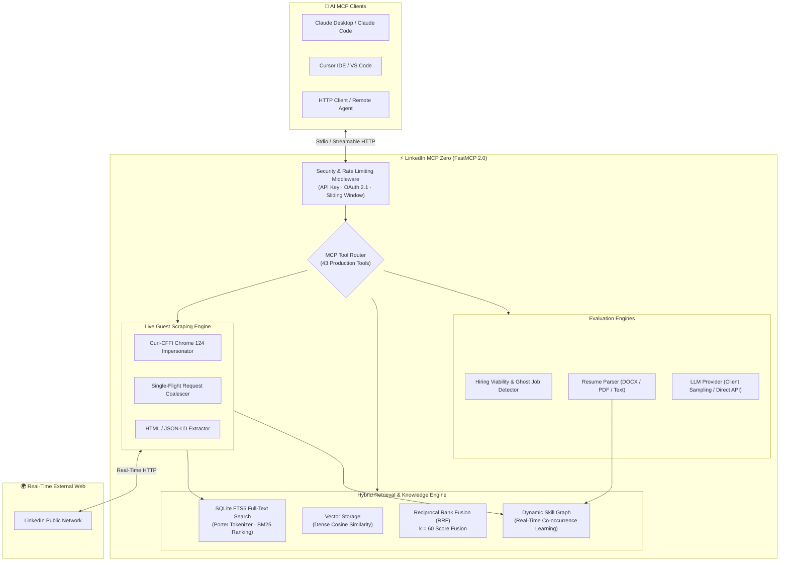

<div align="center">

```text
██╗     ██╗███╗   ██╗██╗  ██╗███████╗██████╗ ██╗███╗   ██╗
██║     ██║████╗  ██║██║ ██╔╝██╔════╝██╔══██╗██║████╗  ██║
██║     ██║██╔██╗ ██║█████╔╝ █████╗  ██║  ██║██║██╔██╗ ██║
███████╗██║██║ ╚████║██║  ██╗███████╗██████╔╝██║██║ ╚████║
             MCP ZERO - real-time LinkedIn intelligence
```

# ⚡ LinkedIn MCP Zero

**A high-performance, public-first Model Context Protocol (MCP) server for real-time LinkedIn job intelligence, hybrid semantic matching, ghost-job viability scoring, dynamic skill graphs, and privacy-first resume analysis.**

*Zero Login Required · Zero Mock Data · Real-Time Dynamic Learning · Dual Stdio/HTTP Transports · PyPI Published*

---

[](https://pypi.org/project/linkedin-mcp-zero/)
[](https://www.python.org/)
[](LICENSE)
[](https://modelcontextprotocol.io/)
[](https://github.com/SanthaKumar-K-2004/linkedin-mcp-zero/actions)
[](https://codecov.io/gh/SanthaKumar-K-2004/linkedin-mcp-zero)
[](https://mypy-lang.org/)
[](https://bandit.readthedocs.io/)

</div>

---

## 🌟 Key Highlights & What's New in v0.4.0

- 🌐 **100% Real-Time & Authentic Data**: Pure live execution against LinkedIn's public endpoints. Zero fake datasets, zero mock responses, and zero pre-seeded static taxonomies.
- 🧠 **Dynamic Real-Time Skill Graph**: Learns technology co-occurrences on-the-fly directly from actual job postings and candidate resumes into an in-process SQLite graph (`weight = weight + 1.0`).
- ⚡ **Hybrid RAG & Reciprocal Rank Fusion (RRF)**: Fuses lexical BM25 ranking (via SQLite FTS5 with Unicode61 Porter tokenization) with dense vector semantic search ($k=60$).
- 🛡️ **Ghost Job & Applicant Saturation Engine** (`analyze_job_viability`): Algorithmic detection of recycled postings, applicant pool hyper-saturation, and stale recruitment cycles.
- 🚀 **Dual Transport Architecture**: Native support for **stdio** (Claude Desktop, Cursor, Claude Code) and **streamable-http** (remote web hosting, microservices, OAuth 2.1 protected).
- 🔒 **Enterprise-Grade Hardening**: Single-flight request coalescing (prevents thundering herds), cryptographically secure `secrets` jitter, RFC 6585 rate limiting, and formula injection sanitization.

---

## 🎨 System Flow & Architecture



---

## 📊 Feature Comparison Matrix

| Feature | stickerdaniel (2.3k★) | Standard MCPs | **LinkedIn MCP Zero v0.4.0** |
| :--- | :---: | :---: | :---: |
| **Zero-Login Public Search** | ❌ None | ⚠️ 0–2 tools | **✅ 32 Public Tools** |
| **Authentic Real-Time Scraping** | ❌ None | ⚠️ Static/Mock | **✅ 100% Live Network** |
| **Dynamic Skill Graph Learning** | ❌ None | ❌ None | **✅ Live Co-occurrence Graph** |
| **Full-Text BM25 Ranking** | ❌ None | ❌ None | **✅ SQLite FTS5 Integrated** |
| **Hybrid RRF Search Fusion** | ❌ None | ❌ None | **✅ Lexical + Dense RRF** |
| **Ghost Job & Viability Scoring** | ❌ None | ❌ None | **✅ Yes (`analyze_job_viability`)** |
| **Local Resume Parsing (PDF/DOCX)**| ❌ None | ❌ None | **✅ Zero Account Risk** |
| **Dual Transport (Stdio & HTTP)** | ⚠️ Stdio only | ⚠️ Stdio only | **✅ Stdio + Streamable HTTP** |
| **Single-Flight Request Coalescing** | ❌ None | ❌ None | **✅ Zero Duplicate Requests** |
| **One-Click Diagnostic Tool** | ❌ None | ❌ None | **✅ Yes (`--doctor` CLI)** |

---

## ⚡ Instant Setup (One Command)

### 1. Automatic Client Config Installation

Install and configure LinkedIn MCP Zero automatically for your favorite AI environment:

```bash
# Claude Desktop
uvx linkedin-mcp-zero --install-client claude-desktop

# Claude Code
uvx linkedin-mcp-zero --install-client claude-code

# Cursor
uvx linkedin-mcp-zero --install-client cursor

# VS Code
uvx linkedin-mcp-zero --install-client vscode
```

### 2. Verify System Readiness
Run the built-in diagnostic doctor to verify your Python runtime, optional extras, and network status:
```bash
uvx linkedin-mcp-zero --doctor
```

---

## 🚀 Live Real-Time Execution Demo

Here is actual live data retrieved from LinkedIn's production network via LinkedIn MCP Zero:

```text
=== REAL-TIME LINKEDIN INSPECTION ===
Query: "Python Backend Engineer" in "New York, NY"

1. Live Public Network Retrieval:
   [1] ID: 4475151136 | Senior Software Engineer, Backend @ Forage (NY, NY)
   [2] ID: 4483675233 | Senior Backend Engineer @ Antidote Health (NY City Metro)
   [3] ID: 4301398088 | Senior Software Engineer, Backend @ Ro (NY, NY)

2. Live Job Detail & Dynamic Skill Extraction:
   Title:    Senior Software Engineer, Backend
   Company:  Forage
   Skills:   ['Python', 'AWS', 'Django', 'AI']
   Desc:     "Forage’s mission is to expand financial access for low-income families..."

3. SQLite FTS5 BM25 Indexing:
   BM25 Search for "Python": Found Forage Backend (Rank: -1e-06)

4. Real-Time Viability & Saturation Analysis:
   Status:          ACTIVE_HIGH_PRIORITY
   Viability Score: 1.0 / 1.0 (0 reposts, fresh posting, optimal saturation)

5. Dynamically Learned Graph Connections:
   "Python" dynamically linked to:
      -> django (weight: 1.9)
      -> aws (weight: 1.0)
      -> ai (weight: 1.0)
      -> asyncio (weight: 1.0)
```

---

## 🌐 Hosting & Production Deployment

LinkedIn MCP Zero can be hosted locally or deployed to cloud platforms (Docker, AWS, GCP, Fly.io) via **Streamable HTTP** mode.

### Running the HTTP Server Daemon
```bash
# Launch server with custom API authentication key
LINKEDIN_MCP_API_KEY="your-secret-api-key" uvx linkedin-mcp-zero \
    --transport streamable-http \
    --host 0.0.0.0 \
    --port 8000
```

### Endpoints

- **MCP 2.0 Streaming Endpoint**: `http://localhost:8000/mcp`
- **System Health & DB Probe**: `http://localhost:8000/health`
- **OAuth 2.1 Metadata**: `http://localhost:8000/.well-known/oauth-protected-resource`

### Connecting Clients Over HTTP
Add to your client's `claude_desktop_config.json` or `mcp.json`:
```json
{
  "mcpServers": {
    "linkedin-zero": {
      "url": "http://localhost:8000/mcp",
      "headers": {
        "x-api-key": "your-secret-api-key"
      }
    }
  }
}
```

### Docker Deployment
```bash
docker build -t linkedin-mcp-zero .
docker run -p 8000:8000 -e LINKEDIN_MCP_API_KEY="your-key" linkedin-mcp-zero
```

---

## 🛠️ Complete Tool Catalog (43 Tools)

### Default Core Tools (32 Working Tools — Zero Login Required)

| # | Tool | Short | Function | Safety Level |
|:---:|:---|:---:|:---|:---|
| 1 | `search_jobs` | `sj` | Search public LinkedIn postings by keyword & location | Public (No Login) |
| 2 | `search_jobs_multi` | `sjm` | Multi-board cross-search (Indeed, Glassdoor, LinkedIn) | Public (No Login) |
| 3 | `get_job_details` | `gj` | Full job description, salary, and requirements from URL | Public (No Login) |
| 4 | `get_company_jobs` | `gcj` | List all open roles at a specified company | Public (No Login) |
| 5 | `get_company_profile` | `gcp` | Public organizational profile and hiring velocity | Public (No Login) |
| 6 | `search_companies` | `sc` | Discover companies matching targeted keywords | Public (No Login) |
| 7 | `get_job_salary` | `gjs` | Extract structured compensation data from postings | Public (No Login) |
| 8 | `get_job_trends` | `gjt` | Analyze regional hiring demand and trends | Public (No Login) |
| 9 | `get_industry_insights`| `gii`| Sector-wide hiring distribution and momentum | Public (No Login) |
| 10 | `search_jobs_advanced`| `sja`| Filtered query with experience, remote, and age facets | Public (No Login) |
| 11 | `analyze_resume` | `ar` | Parse local PDF, DOCX, or text resume into structured data | Local (Zero Risk) |
| 12 | `get_resume_insights` | `gri`| Identify candidate skill gaps and improvement points | Local (Zero Risk) |
| 13 | `match_jobs_to_resume`| `mjr`| Rank live jobs against candidate resume via Hybrid RRF | Local / Public |
| 14 | `compare_jobs` | `cj` | Side-by-side comparative analysis of 2–5 postings | Local / Public |
| 15 | `export_jobs` | `ej` | Export scraped postings to sanitized CSV, JSON, or XLSX | Local (Zero Risk) |
| 16 | `save_job_alert` | `sja_alert`| Save recurring search queries with alerts | Local (Zero Risk) |
| 17 | `get_saved_alerts` | `gsa`| View active job alert configurations | Local (Zero Risk) |
| 18 | `check_saved_alerts` | `csa`| Evaluate active alerts against new live postings | Local / Public |
| 19 | `get_engine_status` | `ges`| View cache health, circuit breaker state, and DB stats | Local (Zero Risk) |
| 20 | `get_help` | `gh` | Retrieve tool documentation and parameter schemas | Local (Zero Risk) |
| 21 | `get_usage_stats` | `gus`| Track token consumption and payload estimations | Local (Zero Risk) |
| 22 | `get_tool_usage_summary`| `gtus`| Aggregated usage metrics by tool invocation | Local (Zero Risk) |
| 23 | `reset_usage_stats` | `rus`| Clear local metrics history | Local (Zero Risk) |
| 24 | `smart_match_jobs` | `smj`| AI-driven candidate match reasoning with client LLM | Local / Public |
| 25 | `generate_cover_letter`| `gcl`| Generate tailored, high-converting cover letters | Local / Public |
| 26 | `analyze_salary_offer` | `aso`| Evaluate compensation fairness against market data | Local / Public |
| 27 | `personalized_job_hunt`| `pjh`| Interactive job search tailored to user career preferences| Local / Public |
| 28 | `confirm_export` | `ce` | User-confirmed file exports with path sanitization | Local (Zero Risk) |
| 29 | `get_resume_insights_advanced`| `ria`| Deep resume critique with scoring heuristics | Local (Zero Risk) |
| 30 | `deep_industry_analysis`| `dia`| In-depth industry landscape with progress tracking | Local / Public |
| 31 | `analyze_job_viability`| `ajv`| **Ghost job probability & applicant saturation scoring** | Public (No Login) |
| 32 | `expand_skill_cluster` | `esc`| **In-process dynamic skill graph ecosystem exploration** | Local (Zero Risk) |

### Opt-In Browser Tools (+11 Tools — Read-Only CDP)
*Requires Chrome with remote debugging (`google-chrome --remote-debugging-port=9222`) and `--with-extra browser`.*

| # | Tool | Function | Safety Level |
|:---:|:---|:---|:---|
| 33 | `get_my_profile` | Read personal profile summary & experience | Read-Only Browser |
| 34 | `get_person_profile` | Read public/connection profile page | Read-Only Browser |
| 35 | `search_people` | People search through authenticated session | Read-Only Browser |
| 36 | `get_my_connections` | Read connection roster and metadata | Read-Only Browser |
| 37 | `get_inbox` | List recent conversation summaries | Read-Only Browser |
| 38 | `get_conversation` | Read conversation messages (SSRF-guarded) | Read-Only Browser |
| 39 | `get_feed` | Read LinkedIn home feed posts | Read-Only Browser |
| 40 | `get_notifications` | Read incoming network notifications | Read-Only Browser |
| 41 | `get_sidebar_profiles` | Extract sidebar profile recommendations | Read-Only Browser |
| 42 | `get_company_employees`| Read company employee directory | Read-Only Browser |
| 43 | `check_session` | Verify CDP connectivity and login state | Read-Only Browser |

---

## 🔒 Security & Privacy Model

LinkedIn MCP Zero follows strict **defense-in-depth security principles**:

- **Zero-Login First**: 32 of 43 tools operate completely unauthenticated, eliminating account suspension risks.
- **CSV Formula Injection Sanitization**: All exported cells starting with `=`, `+`, `-`, `@`, or `\t` are escaped with `'` to prevent spreadsheet code execution.
- **SSRF Domain Protection**: Browser conversation readers enforce strict domain validation to prevent unauthorized network pivoting.
- **Cryptographic Randomness**: All jitter and User-Agent rotations utilize Python `secrets` instead of pseudo-random generators.
- **Strict Rate Limiting & Circuit Breakers**: Sliding-window rate limiters with RFC 6585 `Retry-After: 60` headers and thread-safe circuit breakers.
- **Zero Data Leakage**: User resumes, personal inbox transcripts, and candidate profiles are never shared externally or used for model training.

---

## 💻 Local Development & Testing

```bash
# Clone and install development environment
git clone https://github.com/SanthaKumar-K-2004/linkedin-mcp-zero.git
cd linkedin-mcp-zero
uv sync --extra dev

# Run comprehensive test suite (105 tests)
uv run pytest --cov=linkedin_mcp_zero --cov-report=term-missing

# Lint and format checks
uv run ruff check .
uv run ruff format --check .

# Static type verification (Strict Mode)
uv run mypy src/

# Automated Security Scan
uv run bandit -r src/ -x tests -ll

# Build distribution bundle
uv build
```

---

## 📄 License

Licensed under the **Apache License, Version 2.0**. See the [LICENSE](LICENSE) file for full details.

> [!NOTE]
> **Educational & Research Notice**: LinkedIn MCP Zero is developed for research, workflow automation, and educational analysis. Please adhere to applicable platform terms and use responsibly.
