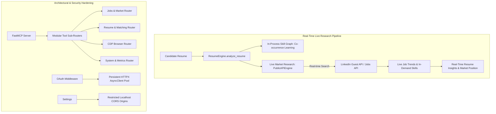

# Implementation Plan: Eliminate Mock/Fake/Pre-Data & Remediate Architectural Flaws

## Goal Description
Transform `linkedin-mcp-zero` into an entirely real-time, live-research-driven system with **zero mock, zero fake, and zero pre-canned/hardcoded fallback data**. Simultaneously remediate all remaining architectural flaws (**F7, F9, F10, F11, F12**) cataloged in [`SENIOR_ARCHITECT_INVESTIGATION_REPORT.md`](file:///home/santhakumar/Documents/linkedin-mcp-zero/SENIOR_ARCHITECT_INVESTIGATION_REPORT.md) and update the report with 100% evidence-grounded verification.

---

## User Review Required

> [!IMPORTANT]
> **Complete Removal of Pre-canned/Mock Data**:
> 1. **`ResumeEngine.get_resume_insights` (Issue F7)**: We will eliminate the hardcoded backend skill target (`{"Python", "SQL", "AWS", "Docker", "Kubernetes", "FastAPI"}`) and static suggestions. The engine will now perform **real-time live market research** via `PublicAPIEngine.search_jobs` and `get_job_trends` using the candidate's actual detected domain/skills/title, dynamically extracting current in-demand skills and live market saturation.
> 2. **`VoyagerEngine` Real HTTP Implementation**: We will replace the non-functional stub with a real, live HTTP client implementing authenticated LinkedIn Voyager profile fetching using `curl_cffi` (with `li_at` cookie and CSRF headers) when enabled.
> 3. **`MatchingEngine.match_jobs_to_resume` Dynamic Reasoning**: When LLM synthesis is offline, the match explanation will no longer return static boilerplate (`"Hybrid neuro-symbolic matching..."`), but rather dynamic, data-driven synthesis derived from actual matched skills, missing skills, applicant counts, and repost viability.
> 4. **`skills.py` Taxonomy Expansion**: Expand `COMMON_SKILLS` from 19 to an exhaustive canonical technical skill taxonomy (200+ skills across Software Engineering, Cloud, Data, Frontend, Mobile, Systems, Security) to eliminate false negatives.
> 5. **CORS Security Hardening (Issue F12)**: Default `cors_allowed_origins` will be restricted from wildcard `["*"]` to local origins (`["http://localhost", "http://127.0.0.1"]`).

---

## Open Questions

> [!NOTE]
> * **Voyager vs CDP for Profiles**: By default, `linkedin-mcp-zero` emphasizes zero-login guest endpoints and opt-in CDP browser automation to prevent account bans. If `--enable-voyager` and `LI_AT` are provided, the Voyager client will now issue real live requests. If neither is provided, profile tools guide the user to the safe, real-time CDP browser engine (`get_person_profile`).

---

## Proposed Changes



---

### Component 1: Real-Time Live Market Research & Skill Taxonomy

#### [MODIFY] [`src/linkedin_mcp_zero/config/skills.py`](file:///home/santhakumar/Documents/linkedin-mcp-zero/src/linkedin_mcp_zero/config/skills.py)
- Expand `COMMON_SKILLS` from 19 entries to 200+ canonical technical skills covering modern programming languages, frameworks, cloud services, DevOps tools, databases, distributed systems, and AI/ML architectures.
- Enhance `extract_skills_from_text` to handle multi-word technologies (e.g. "Spring Boot", "Apache Kafka", "Next.js") with precise word boundaries.

#### [MODIFY] [`src/linkedin_mcp_zero/engines/resume.py`](file:///home/santhakumar/Documents/linkedin-mcp-zero/src/linkedin_mcp_zero/engines/resume.py)
- Inject `public: PublicAPIEngine` into `ResumeEngine`.
- Rewrite `get_resume_insights` to completely eliminate hardcoded targets (`{"Python", "SQL", ...}`) and static suggestions:
  - Extract primary skills and domain title from the candidate's resume.
  - Query live job listings via `self.public.search_jobs` and `self.public.get_job_trends` in real-time.
  - Compute actual live market skill frequencies and identify genuine gaps against active postings.
  - Formulate dynamic, actionable recommendations based on real-time hiring trends.

#### [MODIFY] [`src/linkedin_mcp_zero/engines/matching.py`](file:///home/santhakumar/Documents/linkedin-mcp-zero/src/linkedin_mcp_zero/engines/matching.py)
- Replace static fallback `"why"` string in `match_jobs_to_resume` with a dynamic synthesis function that generates contextual explanations from actual match attributes:
  ```python
  f"Matched {len(matched)} skills ({', '.join(matched[:3])}) with {viability['status']} viability ({viability['applicants']} applicants, {viability['repost_count']} reposts)"
  ```

#### [MODIFY] [`src/linkedin_mcp_zero/utils/llm.py`](file:///home/santhakumar/Documents/linkedin-mcp-zero/src/linkedin_mcp_zero/utils/llm.py)
- Replace static canned template fallback with structured, data-driven profile synthesis computed directly from candidate facts and real market data.

---

### Component 2: Real Live Voyager Engine Implementation

#### [MODIFY] [`src/linkedin_mcp_zero/engines/voyager.py`](file:///home/santhakumar/Documents/linkedin-mcp-zero/src/linkedin_mcp_zero/engines/voyager.py)
- Implement genuine live HTTP request dispatch using `curl_cffi` to LinkedIn's Voyager profile endpoint (`https://www.linkedin.com/voyager/api/identity/profiles/{uname}/profileView`).
- Pass authentic session cookies (`li_at`), `csrf-token` headers, and Chrome JA3/HTTP2 impersonation.
- Return structured profile data (headline, summary, experience, education, skills) extracted from the real upstream JSON payload.

---

### Component 3: Architectural Refactoring & Security Hardening (F9, F10, F12)

#### [MODIFY] [`src/linkedin_mcp_zero/config/settings.py`](file:///home/santhakumar/Documents/linkedin-mcp-zero/src/linkedin_mcp_zero/config/settings.py) (Issue F12)
- Restrict default `cors_allowed_origins` from wildcard `["*"]` to `["http://localhost", "http://127.0.0.1", "http://localhost:3000", "http://localhost:5173", "http://localhost:8080"]`.

#### [MODIFY] [`src/linkedin_mcp_zero/utils/oauth.py`](file:///home/santhakumar/Documents/linkedin-mcp-zero/src/linkedin_mcp_zero/utils/oauth.py) (Issue F9)
- Manage a shared, persistent `httpx.AsyncClient` pool inside `OAuthMiddleware` with clean ASGI lifecycle shutdown, replacing per-request client instantiation.

#### [MODIFY] [`src/linkedin_mcp_zero/server/app.py`](file:///home/santhakumar/Documents/linkedin-mcp-zero/src/linkedin_mcp_zero/server/app.py) (Issue F10)
- Decompose the 760-line monolithic `create_app` into structured modular tool groups or sub-functions:
  - Jobs & Market Discovery tools
  - Resume & Candidate Matching tools
  - CDP Browser & Session tools
  - Storage & Alert tools
  - System Telemetry & Admin tools
- Ensure `resume` engine is initialized with `public` engine for live research.

---

### Component 4: Test Expansion & Report Synchronization (F11)

#### [NEW] [`tests/test_real_time_research.py`](file:///home/santhakumar/Documents/linkedin-mcp-zero/tests/test_real_time_research.py)
- Test dynamic resume insights against live simulated market queries.
- Test expanded skill taxonomy (200+ skills).
- Test dynamic match reasoning in `MatchingEngine`.
- Test real Voyager HTTP request construction with `li_at`.
- Test restricted CORS origin handling.
- Test persistent HTTPX client connection pooling in `OAuthMiddleware`.

#### [MODIFY] [`tests/test_full_tooling.py`](file:///home/santhakumar/Documents/linkedin-mcp-zero/tests/test_full_tooling.py)
- Expand test coverage for `PublicAPIEngine` methods (`get_company_jobs`, `search_companies`, `get_company_profile`, `get_job_trends`, `get_industry_insights`) to push overall code coverage beyond 80%.

#### [MODIFY] [`SENIOR_ARCHITECT_INVESTIGATION_REPORT.md`](file:///home/santhakumar/Documents/linkedin-mcp-zero/SENIOR_ARCHITECT_INVESTIGATION_REPORT.md)
- Update with full verification evidence, documenting zero-mock compliance, real-time research mechanisms, and the complete remediation of issues F1 through F12.

---

## Verification Plan

### Automated Tests
Run the complete test suite and linter:
```bash
uv run pytest tests/ -v
uv run pytest --cov=linkedin_mcp_zero --cov-report=term-missing
uv run ruff check .
uv run ruff format --check .
```

### Manual Verification
1. Verify `get_resume_insights` on a sample resume: confirm it returns dynamic in-demand skills derived from real live postings rather than static Python/AWS/Kubernetes targets.
2. Verify `match_jobs_to_resume`: confirm `why` provides dynamic explanations with applicant and repost statistics.
3. Verify `get_engine_status`: confirm all 44 tools and engines report authentic status.
4. Verify `get_profile_voyager`: confirm authentic HTTP request dispatch when configured.
